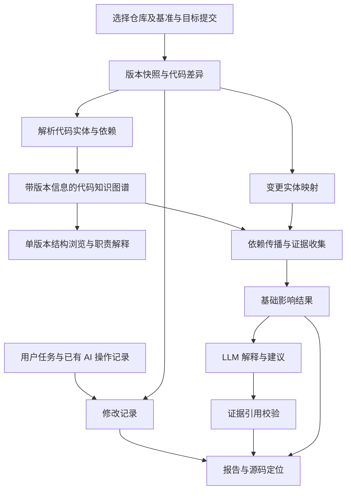

# 概念架构草案

状态：用于需求讨论的逻辑设计。模块划分不等同于独立服务或最终部署方案。

课程原型需要支持两条入口：单版本的项目结构理解，以及关联 AI 修改任务的两个版本影响分析。建议以单应用、本地运行、单任务处理起步，后续根据演示需要补充能力。

## 处理流程

## 逻辑模块

| 模块 | 职责 | 主要输出 |
| --- | --- | --- |
| 交互入口 | 接收分析请求并展示状态与报告 | 仓库标识、提交引用、分析配置 |
| 任务协调 | 固化提交版本，协调阶段执行并记录状态 | 分析任务与阶段日志 |
| 仓库读取 | 获取明确版本的源码与差异，不执行被分析项目的脚本 | 源码快照和变更文件列表 |
| 代码解析 | 提取实体、定位与可解析的关系，记录不支持项 | 实体、边、解析诊断 |
| 图谱访问 | 按仓库及版本保存、查询结构化代码关系 | 图快照与关系查询结果 |
| 结构说明 | 展示模块及文件关系，并结合源码说明主要职责 | 结构图、带依据的简短说明 |
| 修改记录 | 关联用户任务、前后提交及人工附加的原始操作记录 | 修改任务与可核对的过程记录 |
| 变更映射 | 将代码差异映射到两个版本的实体 | 新增、删除、修改及不确定匹配 |
| 影响分析 | 按关系类型追踪依赖，保留路径与截断原因 | 影响候选集与证据集合 |
| LLM 分析 | 基于受控证据生成语义解释和建议 | 带证据标识的解释草稿 |
| 报告生成 | 校验证据引用并汇总状态、结果与局限 | 可浏览、可导出的影响报告 |

实际实现可以先在单一应用中组织这些模块；是否需要任务队列、独立图数据库或服务拆分，取决于后续验证。

## 多语言适配思路

各语言解析器输出相同格式的实体、关系、源码位置和诊断信息，图谱与界面使用这一公共格式。每个解析器明确声明可提取的实体及关系能力，不能因支持文件语法就宣称支持完整调用分析。

建议首版先打通一种语言；若有余量，再接入第二种语言验证接口。混合仓库可展示各已支持语言的分析结果，但跨语言调用关系需要单独处理，暂不承诺自动推导。

## 图谱模型起点

建议先评估以下实体与关系，按首批语言的实际解析能力收敛：

- 实体：仓库、版本、文件、模块、类、函数或方法、测试。
- 关系：包含、导入、调用、引用、继承、实现、测试关联。
- 实体属性：仓库标识、提交 SHA、实体类别、语言、限定名称、路径、源码范围及提取来源。
- 关系属性：起点、终点、关系类型、所属版本、提取方式、证据位置与解析状态。

快照内实体 ID 必须唯一。跨版本实体匹配应独立记录，不能假设名称与行号始终稳定。测试关联应注明来自静态引用、覆盖数据还是人工标注；首版未支持的来源不应伪造。

## 影响传播约定

- 若 A 调用 B，则 B 变更时沿调用边的反向寻找 A；不同关系分别定义传播规则。
- 删除实体使用基准版本的关系；新增实体使用目标版本的关系；修改实体结合两侧关系和匹配信息分析。
- 对循环依赖使用访问集合；对遍历深度、候选数量和证据大小设置可配置边界，并在报告中展示截断。
- 静态依赖支持“可能受影响”的判断。动态分派、反射、运行时配置等缺口应明确报告。
- 初期排序可依据传播距离、关系类型及证据完整性；具体权重需通过实验确定，不将未经校准的分数称为发生概率。

## LLM 的输入输出边界

输入包括变更摘要、相关源码片段、影响路径和证据标识。输出包含影响解释、测试建议、证据引用以及需人工复核的推测。

结构说明使用单版本图谱和相关源码作为依据。修改报告可同时引用用户任务与真实操作记录；仅有前后提交时，只能解释实际改动与潜在影响，无法还原 AI 未记录的执行过程或内部思考。

代码与注释作为待分析数据处理，其中的指令不用于改变系统行为。报告生成前校验证据标识是否存在、是否属于本次任务，以及源码定位是否对应正确提交。引用合法不代表解释必然正确，解释质量仍需人工抽样评估。

模型不可用或证据超出上下文预算时，保留基础结果，说明缺失或截断的范围。

## 待解决的架构问题

1. 如何按首选语言完成符号解析与调用目标识别？
2. 图数据存储、任务状态存储是否需要不同组件？
3. 哪些实体匹配与关系传播规则能在首版可靠实现？
4. 是否需要增量构图，如何防止跨版本数据污染？
5. 前端展示、身份认证和部署环境的实际需求是什么？
6. 外部模型可访问的数据范围与失败处理策略是什么？
